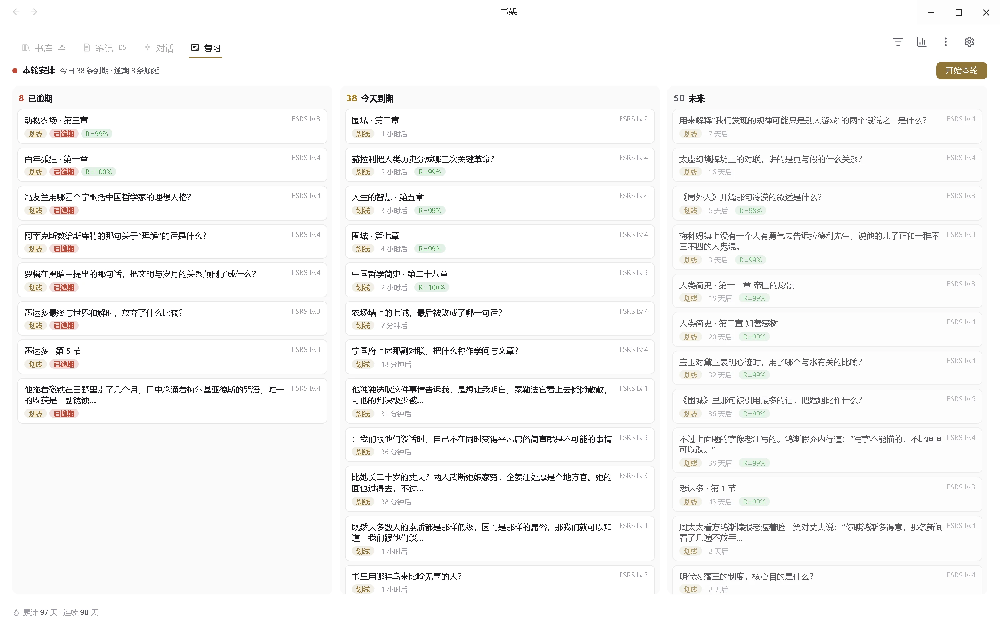
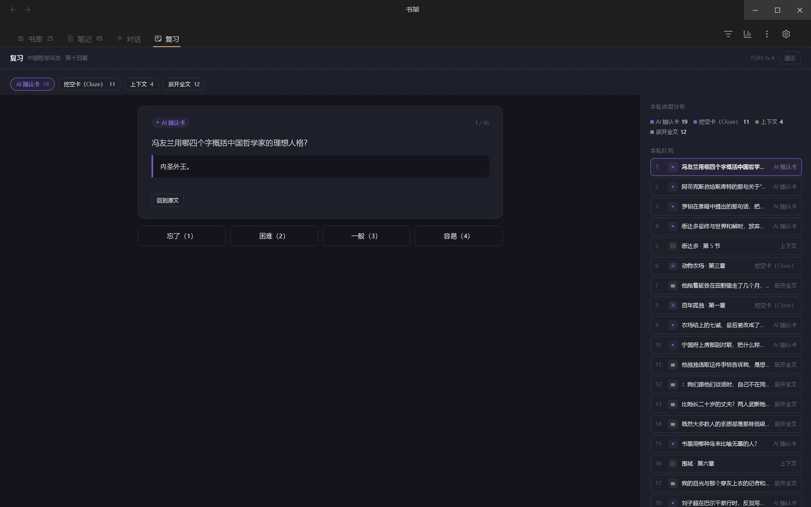
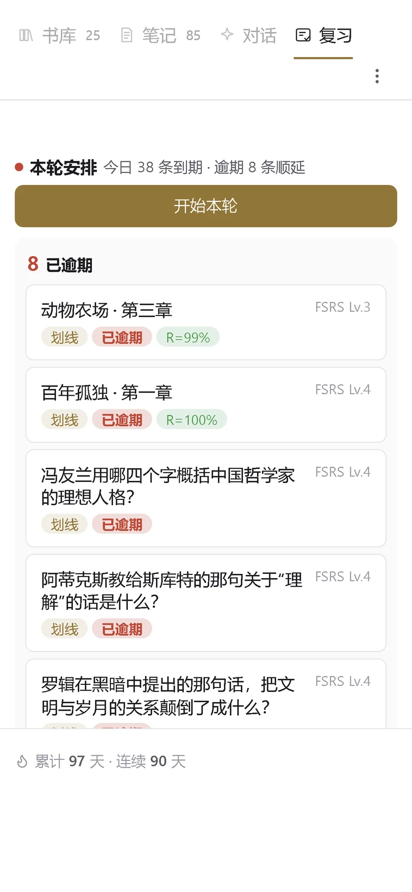
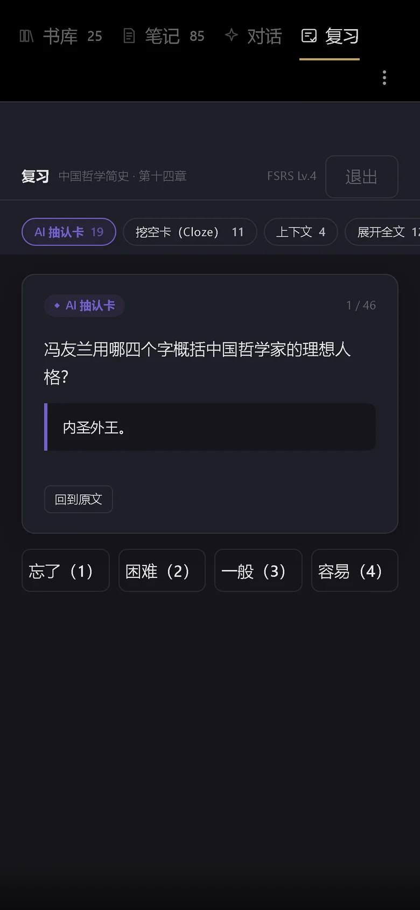
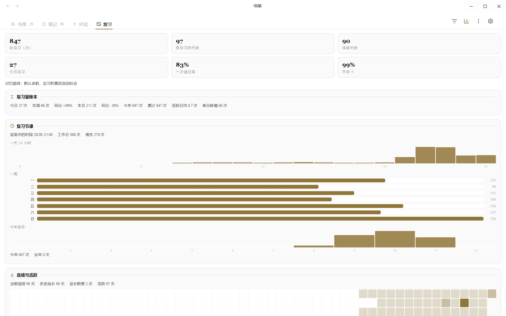

  

  <h1>bz Review（复习）</h1>
  
<b>bz Review 把制卡、整卡交给 AI，让你专注阅读与复习。</b> 
  内置 FSRS 间隔重复算法，依据记忆稳定性动态排期，并按你的复习记录自适应拟合参数。用更少的复习次数，记得更牢。

  

    
    
    
    
    
    
  

  
QQ 群 1130883117 · <a href="#support">支持作者</a>

  
<b>简体中文</b> · <a href="#english">English</a>

  

<b>复习计划 · 今日到期 · 逾期 · 未来</b>

  

<b>抽认卡 · AI 出题 · 四档评级（暗色）</b>

  
  &nbsp;&nbsp;
  

<b>移动端 · 复习计划 · 抽认卡</b>

## 安装

在社区市场安装（首次上架审核通过后可见）：

1. 打开 **设置 → 第三方插件**，关闭安全模式。
2. 点 **浏览**，搜索 **bz Review**，安装。
3. 启用后左侧出现日历勾图标，点开就是复习计划。

审核期间或搜不到时，用 [BRAT](https://github.com/TfTHacker/obsidian42-brat) 添加本仓库安装，或手动下载 Release 里的 `main.js`、`manifest.json`、`styles.css`，放进 `<你的库>/.obsidian/plugins/bz-review/` 后启用。

## 视频教程

视频还在制作中，做好后会在这里补上链接；插件里的「看视频教程」按钮也会同步指向它。

## 功能

基础版免费、不限时，制卡 50 张；高级版不限量。两版功能完全一样，以后新增的功能也一样。

| 类别 | 功能 | 基础版 | 高级版 |
|---|---|:---:|:---:|
| **数量** | 制卡数量 | 50 张 | 不限 |
| **制卡** | 选中文字加一张 | ✓ | ✓ |
|  | 划线一键加入 | ✓ | ✓ |
|  | 整本书批量挑：按划线 / 重点 / 章节 | ✓ | ✓ |
|  | 手动写一张 | ✓ | ✓ |
|  | Markdown 笔记导入 | ✓ | ✓ |
|  | Anki 牌组导入 | ✓ | ✓ |
|  | 模板与图片 / 音频 | ✓ | ✓ |
| **复习** | 抽认卡 | ✓ | ✓ |
|  | 做题（四选一） | ✓ | ✓ |
|  | 挖空 | ✓ | ✓ |
|  | 上下文 | ✓ | ✓ |
|  | 展开全文 | ✓ | ✓ |
| **排期** | FSRS-7 排期 | ✓ | ✓ |
|  | 参数自动拟合 | ✓ | ✓ |
|  | 学习步骤 | ✓ | ✓ |
|  | 负荷预测与假期 | ✓ | ✓ |
| **管理** | 卡片管理器：挂起 / 埋藏 / 手动排期 | ✓ | ✓ |
|  | 牌组与标签 | ✓ | ✓ |
|  | AI 重新生成卡片 | ✓ | ✓ |
| **数据与备份** | 记忆分析 | ✓ | ✓ |
|  | 统计与成就 | ✓ | ✓ |
|  | 按书报告 | ✓ | ✓ |
|  | 导出 Markdown / CSV | ✓ | ✓ |
|  | 快照备份 | ✓ | ✓ |
|  | 一键回滚 | ✓ | ✓ |
| **联动** | 听卡片（本地 TTS） | ✓ | ✓ |
|  | 跳回原文 | ✓ | ✓ |
|  | 书架复习页签 | ✓ | ✓ |
|  | 文件夹监听自动加入 | ✓ | ✓ |

合计 29 项功能，两版完全一致，仅「制卡数量」一项不同；以后新增的功能也一律两边都有。已有数据超过免费上限不会被删，只是不能再加新的。

完整的同款对照长图见 [`assets/plan-compare/shots/pro-compare.png`](assets/plan-compare/shots/pro-compare.png)（店铺详情也只放这一张）。

## 付费说明

基础版免费，功能完整、不限时。高级版需要付费购买激活码：[购买页面](https://wzyp.cn/shop/IFCEI5I3)，具体价格以该页面为准。

- 激活码在 **复习计划 → 设置 → 授权** 里填入，本地验签，不联网。
- 不绑定设备数：换电脑或手机时，在新设备的同一位置再填一次即可。
- 桌面端与移动端是同一个包，买一次两边都能用。
- 激活码范围：**赞助人与专属定制码**（码里带 `patron` 标记）在 bz Reader 和 bz-review 都能激活；两款插件的普通高级版码各自独立，只在对应插件激活。

## 两种复习方式

每张卡在制卡时就定好自己的方式，一轮里可以混排，切到哪张就实时换成哪种题面：

| 方式 | 怎么考 | 要不要 AI |
|---|---|---|
| **抽认卡** | 正面一句问句，背面划线原文 | 有 AI 更准，没有就用内置提示 |
| **做题** | AI 从划线 / 笔记出选择题，按正确率自动定难度 | 要 AI |

## 排期是怎么算的

- **Anki 式学习步骤**：新卡先在当天按 1 分钟、10 分钟重复两次（可在设置里改/关），走完才毕业进入 FSRS——照搬 Anki 的主流设计，新卡不会因为首次点「简单」就被扔到几十天后。已经毕业的卡点「忘了」也会先走同样的当天重学步骤。
- **FSRS-7 全量调度**：官方最新版算法，毕业后每一步都由 FSRS 排期。记忆状态用长期/短期双稳定性 + 难度动态描述，两条遗忘曲线加权算出当前留存率，再按目标留存率反推下一次间隔。
- **目标留存率可调**：默认 90%（官方推荐值，记得牢与复习量的平衡点），可在设置里调高（更勤、间隔更短）或调低（更省时、忘得更多）。
- **Anki 间隔抖动（fuzz）**：2.5 天以上的间隔前后随机挪一点（越长挪得越多），学习步骤也多 0~25%（≤5 分钟），把扎堆到期的卡摊到相邻几天；可在设置里关。Easy 毕业间隔保证比 Good 至少长 1 天。
- **四档评级**：忘了 / 困难 / 一般 / 简单。评完立刻重排，并给出撤销。
- **参数可自调**：34 个权重按你的复习记录自动拟合，也能手填；另有间隔缩放系数与最长间隔上限，防止算出几千天等于不再出现。
- **提前与逾期**：留存率掉到阈值以下会提前进入本轮；逾期有每日上限与常驻提醒，提醒不列题目、只报篇数，点「去复习」走完整流程。
- **假期**：设一个结束日期，之前不提醒、不算逾期；那天计划整体顺延，回来不会一屏欠账。
- **负荷预测**：按未来 30 天排程算出每天的复习量，提前看到哪天要挤时间。

### 排期算法的长期仿真验证

排期不是拍脑袋定的。我们直接拿插件里**真实在用的排期代码**（`src/review/fsrs.ts` 的 `FSRS` 与 `scheduleNext`）跑了一场蒙特卡洛仿真：造一个虚拟学生，每天随机新增 0～5 张卡片，到期时按模型算出的真实留存概率决定答对还是答错，再按结果重新排期。为让数字稳健，用 5 个固定随机种子各跑一遍取平均。脚本见 [`scripts/fsrs7-sim-real.ts`](scripts/fsrs7-sim-real.ts)（每天加卡数、种子、最长间隔都可改）。目标留存率 90%、最长间隔不限（插件默认值）：

| 时间 | 累计新增 | 日增卡 | 累计复习 | 每卡复习次数 | 实际留存率 | again率 | 日均复习 | 单日峰值 | 平均间隔 | 最大间隔 | S_long中位 | 平均难度 | 成熟卡占比 |
|---|---:|---:|---:|---:|---:|---:|---:|---:|---:|---:|---:|---:|---:|
| 1 个月 | 74 | 2.5 | 209 | 2.8 | 86.89% | 13.1% | 7.0 | 13 | 9天 | 26天 | 11天 | 4.13 | 12.7% |
| 半年 | 459 | 2.6 | 2,665 | 5.8 | 87.52% | 12.5% | 19.2 | 27 | 45天 | 294天 | 31天 | 4.70 | 85.1% |
| 1 年 | 911 | 2.4 | 6,658 | 7.3 | 87.85% | 12.1% | 22.7 | 32 | 45天 | 294天 | 86天 | 4.83 | 92.6% |
| 2 年 | 1,794 | 2.1 | 16,922 | 9.4 | 87.73% | 12.3% | 30.3 | 41 | 92天 | 884天 | 87天 | 5.10 | 96.9% |
| 3 年 | 2,689 | 2.0 | 28,734 | 10.7 | 87.63% | 12.4% | 32.6 | 42 | 99天 | 915天 | 242天 | 5.20 | 98.0% |
| 5 年 | 4,525 | 2.5 | 56,893 | 12.6 | 87.65% | 12.4% | 43.9 | 58 | 173天 | 2593天 | 242天 | 5.34 | 98.6% |
| 7 年 | 6,370 | 2.4 | 88,382 | 13.9 | 87.73% | 12.3% | 44.3 | 58 | 208天 | 2593天 | 319天 | 5.42 | 99.0% |
| 10 年 | 9,080 | 2.5 | 139,572 | 15.4 | 87.81% | 12.2% | 50.1 | 63 | 217天 | 3601天 | 682天 | 5.50 | 99.3% |

**怎么看这张表：**

- **留存率长期稳定**：实际留存全程在 86.9%～87.9% 之间，围绕设定的 90% 目标小幅波动，十年不恶化——排期是自我稳定的，不会越用越不准。略低于 90% 是因为仿真按整天排期（间隔取整会带来误差），以及"到期那一刻"的 R 本就略低于目标值。
- **遗忘率是输入不是输出**：`again 率` 稳定在 12% 左右，这是虚拟学生"按真实遗忘概率答题"的直接结果，正好落在 FSRS 90% 目标留存所对应的约 10% 遗忘区间附近。
- **复习负担由加卡速度决定**：每天平均加 2.5 张，日均复习从第一个月 7 次涨到十年后 50 次，单日峰值始终在几十条量级——不是算法失控，而是近万张卡要定期复习的自然结果。**你每天加多少新卡，决定了你未来的复习量。**
- **间隔随成熟度拉开**：平均间隔从第一个月 9 天长到十年后 217 天，中期稳定性（S_long 中位数）从 11 天涨到 682 天，说明记得越牢的卡排得越疏。成熟卡（复习≥3 次）半年就占到 85%，十年后 99%。
- **难度稳定**：平均难度稳定在 4.1～5.5（区间 1～10），没有随使用年限漂移。

> 说明：这是**直接用插件排期代码**做的仿真推演，不是真实用户数据；数字用于验证算法在长期尺度上的稳定性，不代表每个账号的实际数值。虚拟学生的答题概率取自同一套 FSRS 遗忘模型，这与 [Anki 官方 FSRS FAQ](https://docs.ankiweb.net/faqs/frequently-asked-questions-about-fsrs) 对首间隔与留存率的描述一致。

### 多场景长期仿真（年龄段 / 职业 / 使用场景）

上面的表是"一个虚拟学生"的基线。为了做视频、也为了检验算法在不同人群下是否都站得住，又跑了一套**九类人群 × 3 随机种子 × 1 个月到 10 年**的多维仿真：小学生、初中生、高中生、大学生、考研党、考证上班族、医生、程序员、中老年爱好者；作息区分每天 / 工作日 / 断续 / 寒暑假，非活跃日的到期卡会顺延并计入积压。脚本 [`scripts/fsrs-sim-personas.ts`](scripts/fsrs-sim-personas.ts) 直接调用插件的 `scheduleNext()`（含学习步骤、重学、fuzz）。

几个 headline：目标留存率 85% / 90% / 95% / 97% 对应五年日均复习 132 / 186 / 330 / 543 条（85→97 是 4.1 倍）；同样每天 5 张新卡，"每天都学"的单日峰值 95 条，"只在工作日学"却是 152 条并积压 40 条；九类人群十个时间点的实际留存率全程稳定在 90.1%～91.4%。完整数据表（含年龄段汇总、留存率敏感性、作息节奏对照）在 [多场景长期仿真报告](docs/多场景长期仿真报告.md)。给视频用的大白话讲解稿在 [视频讲解素材-算法与Anki大白话.md](docs/视频讲解素材-算法与Anki大白话.md)。

算法是怎么审出来的、Anki 到底抄了什么、哪些坑被修掉了，见 [FSRS-7 对抗审查报告](docs/FSRS-7-对抗审查报告.md)、[Anki 调度规则对照与差距](docs/Anki调度规则对照与差距.md) 和 [对抗审查与真机验证报告](docs/FSRS-7-对抗审查与真机验证.md)。

## 记忆分析

一个独立的分析面板，用「守着一炉记忆的火」作主题，把整库状态画成图：

- **忘坡**：FSRS 遗忘曲线族，横轴是龄期与稳定性之比，纵轴是当前留存率，每篇笔记都在往坡下滑，添一次柴坡就缓一截；
- **水位**：全库平均留存率；
- **欠账**：逾期专页，按逾期天数挂绳，拖得越久挂得越低；
- **阶石**：按复习次数分的 5 档成熟度分布（新卡 0-1 次 / 2-3 次 / 4-7 次 / 8-15 次 / 16+ 次）；
- **墨晶**：稳定性按 <7 / 7–30 / 30–90 / ≥90 天分层的结晶，越久不忘晶格越大；
- **矿层**：难度按 <2 / 2–4 / 4–6 / ≥6 分层，越常「忘了」矿层越沉；
- **批改环与批痕**：评级分布与末次评级分布；
- **四驻**：逾期 / 今天 / 未来 / 已完成四区队列的灯塔快照。

数据页另给复习量账本、24 小时与星期节律、近一年热力、按阶段遗忘率、记忆状态、未来 30 天到期与逾期分档、复习排行，都能导成 CSV；徽章单列在「成就」页，不混在统计里。

## 进阶功能（两版都有）

- **听卡片**：复习时点一下喇叭，用你自己的本地 TTS 服务念卡片（服务地址、音色、格式在设置里填）。合成结果缓存，换卡或退出自动释放，长文本只念前 200 字；离线可用，不按次收费。
- **回到原文**：揭示答案后出现按钮，跳回 bz Reader 里那一句。协议按原文片段定位，不能还原高亮色；老版本 Reader 推来的卡也能靠卡片钥匙兜底跳转。
- **按书档案**：按书名 / 文件夹汇总卡片数、章节数、平均留存率、忘了率与逾期，一键导出 Markdown 报告。
- **卡片管理器**：搜索筛选，挂起 / 埋藏 / 恢复 / 手动排期 / 移出。挂起和埋藏只影响进不进本轮，FSRS 排期字段一个都不动。

## 数据

- 复习数据：`CONFIG/REVIEW/review.json`（可在设置里改目录）；
- 与 bz 的 `CONFIG/STORAGE/review.json` 分开存，两个插件同时装不会互相覆盖；
- 设置里有一键「从 bz 导入」，只导一次、不覆盖、不动 bz 的数据；
- 挂起、埋藏状态一并写进排期表，不依赖运行时内存；
- 支持整包 JSON 备份与恢复、CSV 导出、统计 CSV、划线卡导出为笔记、按书报告导出 Markdown。

## 划线从哪来

划线卡由 [bz Reader](https://github.com/yeshimei/bz-reader) 推送：在书里划一句，选「加入复习」，就会出现在排期表里。Reader 一并给出划线前后各一段与一条跳回原文的链接，复习时可以点「回到原文」。

不装 Reader 也能用：笔记可以直接做成抽认卡或做题，从 Markdown 也能批量导入，写法是 `问题 :: 答案` 或 `{{挖空}}`。

## 网络访问

插件本体不联网、不含任何账号体系。只有两种主动发起的外连：

1. 你配置了 AI 服务商并生成问句或题目时，那条划线会发给你自己填的服务商；没配 AI 时抽认卡退回内置规则，做题需要先配置 AI 服务商。
2. 你点了「听卡片」并配置了本地 TTS 服务时，卡片文字会发给你自己填的本地服务（如 `http://127.0.0.1:5000`），合成结果缓存在插件目录；没配地址时按钮会提示去设置，不发任何请求。

激活码验签、统计、排期、备份全部离线完成，不上传任何内容。

## 常见问题

- **会和其他插件打架吗？** 不会。界面是自己的标签页，生成的 DOM 与 CSS 都限定在插件自己的作用域内（统一挂 `data-bzrv`），不污染别人的样式；数据也和 bz 分开存。
- **和 bz 里的复习计划是什么关系？** 从 bz 独立出来的插件，bz 里那份原样保留。两边各存各的，可以同时装、互不覆盖，也能一键把 bz 的计划导进来。
- **超过免费上限会删我的卡吗？** 不会。已有的笔记和卡继续照常复习，只是制卡满 50 张后不能再加新的；升级后立即放开。批量导入时如果这次会越过 50 张，仍会让你整批加进去，只提醒一句下次要先升级。
- **换电脑怎么办？** 库同步过去，排期和复习历史跟着走；高级版在新设备上重新填一次激活码。
- **手机上要单独买吗？** 不用，同一个包，桌面与移动都包含在内。
- **没装 bz Reader 能用吗？** 能。笔记照样能排进计划，抽认卡和做题两种方式都能用。

## 插件推荐

- [bz](https://github.com/yeshimei/bz) —— 日记、备忘、读书观影、游戏、剪藏、番茄钟、复习、安全加密、AI 知识库、工具坞，还有一只桌宠猫。
- [bz Reader](https://github.com/yeshimei/bz-reader) —— 把 Obsidian 变成一个能读书的地方；在书里划词，就能把句子推进这里的复习计划。

## 支持作者

  

微信扫一扫，请作者喝杯咖啡

插件的开发、维护和教程视频都是作者一个人在做。

**购买高级版：[点击这里](https://wzyp.cn/shop/IFCEI5I3)**

## 许可

本项目以 [MIT](LICENSE) 许可发布。

---

## English

  

<b>Review plan · Due today · Overdue · Upcoming</b>

  

<b>Flashcard · AI-generated · Four ratings (dark)</b>

  
  &nbsp;&nbsp;
  

<b>Mobile · Review plan · Flashcard</b>

  

<b>Stats · Rhythm · Heatmap · Pass rate</b>

Let AI make and organize your cards — you just read and review. Built on FSRS spaced repetition, it schedules reviews from memory stability and fits its parameters to your own history — so you remember more with fewer reviews. Desktop and mobile, all data stays local in your vault.

It was split out of [bz](https://github.com/yeshimei/bz) — the original copy there stays untouched. It pairs with [bz Reader](https://github.com/yeshimei/bz-reader), which pushes highlights into the queue, but Reader is not required.

### Installation

Install from the community directory (visible once the initial review passes):

1. Open **Settings → Community plugins** and turn off Restricted mode.
2. Click **Browse**, search for **bz Review**, and install.
3. Enable it — a calendar-check icon appears in the left ribbon.

While the review is pending, or if search doesn't find it, install with [BRAT](https://github.com/TfTHacker/obsidian42-brat), or download `main.js`, `manifest.json`, and `styles.css` from the Release and place them in `<your vault>/.obsidian/plugins/bz-review/`, then enable the plugin.

### Video tutorial

Still in production — the link will be added here and in the plugin's "video tutorial" button once it's ready.

### Features and pricing

The free edition is complete and unlimited in time: 50 review notes and highlight cards combined. The purchased edition only removes the count — both editions are identical in features, and every future feature will be too. Existing data above the free limit is never deleted.

A single build covers desktop and mobile. License keys are verified locally, offline, and are not tied to a device count — re-enter yours on a new machine. Purchase at the [store page](https://wzyp.cn/shop/IFCEI5I3). bz-review does not accept bz Reader license keys.

### Two ways to review

Flashcards and AI-generated multiple-choice quizzes. Each card keeps its own mode, and a round can mix both.

### Scheduling

Uses the full FSRS-7 algorithm from the first review — no fixed ladder. Memory is tracked with long- and short-term stability plus difficulty, and the next interval is solved from a target retention you can set (90% by default, the official recommendation). Ratings are Again / Hard / Good / Easy. The 34 weights are fitted from your own review history, with manual override, an interval multiplier and a maximum interval. Overdue cards get a daily cap and a reminder; a vacation date stops reminders and shifts the whole plan on the end date. A 30-day workload forecast shows what's coming.

### Data and network

Review data lives in `CONFIG/REVIEW/review.json`, separate from bz's. Backup/restore is JSON or CSV; CSS and generated DOM are scoped to the plugin so other plugins are unaffected. There is no account system and no telemetry. Two things can go online, only when you ask: AI generation sends the selected text to the endpoint you configured in settings, and "speak card" sends card text to your own local TTS service. Everything else runs offline.

### FAQ

- **Does it conflict with other plugins?** No. Its view is a separate tab, styles are scoped, and data is stored separately.
- **Do I lose cards when I hit the free limit?** No. They keep reviewing; you just can't add more until you upgrade.
- **Do I need bz Reader?** No. Notes work on their own; both review modes are available without it.
- **Do I pay again on mobile?** No. One build covers both.

### License

Released under the [MIT](LICENSE) license.
