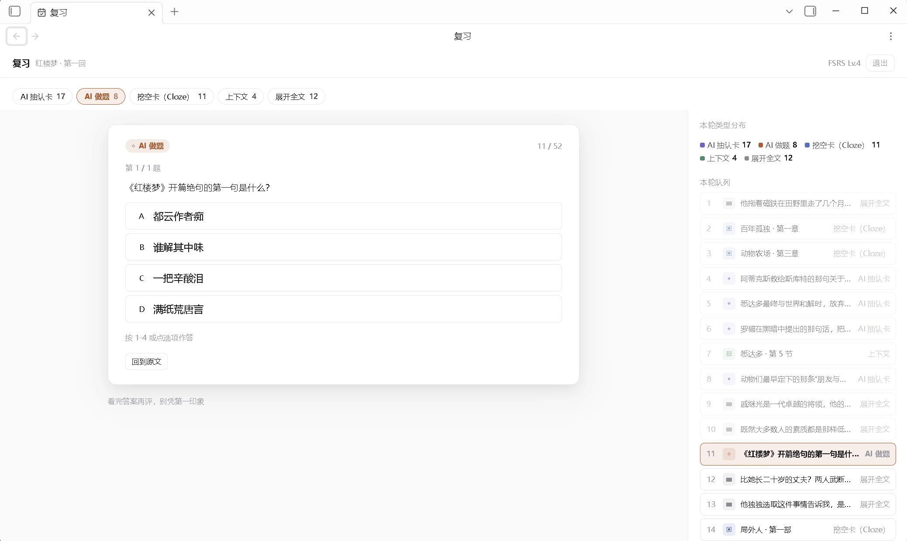

  

  <h1>bz Review（复习）</h1>
  
<b>bz Review 把制卡、整卡交给 AI，让你专注阅读与复习。</b> 
  <b>内置 FSRS 间隔重复算法，依据记忆稳定性动态排期，并按你的复习记录自适应拟合参数。用更少的复习次数，记得更牢。</b>

  

    
    
    
    
    
  

  

    
    
  

  
QQ 群 1130883117 · <a href="#support">支持作者</a>

  
<b>简体中文</b> · <a href="#english">English</a>

  

<b>复习计划 · 今日到期 · 逾期 · 未来</b>

  

<b>AI 做题 · 四选一 · 即时判分</b>

## 安装

在社区市场安装：

1. 打开 **设置 → 第三方插件**，关闭安全模式。
2. 点 **浏览**，搜索 **bz Review**，安装。
3. 启用后左侧出现日历勾图标，点开就是复习计划。

搜不到时，用 [BRAT](https://github.com/TfTHacker/obsidian42-brat) 添加本仓库安装，或手动下载 Release 里的 `main.js`、`manifest.json`、`styles.css`，放进 `<你的库>/.obsidian/plugins/bz-review/` 后启用。

## 视频教程

视频制作中，做好后在这里和插件里的「看视频教程」按钮同步更新。

## 功能

基础版免费、不限时，复习笔记 + 划线卡合计 50 条；高级版不限量。两版功能完全一样，以后新增的功能也一样。

| 类别 | 功能 | 基础版 | 高级版 |
|---|---|:---:|:---:|
| **数量** | 复习条目（笔记 + 划线卡） | 合计 50 条 | 不限 |
| **制卡** | 选中文字加一张 | ✓ | ✓ |
|  | 划线一键加入 | ✓ | ✓ |
|  | 整本书批量挑：按划线 / 重点 / 章节 | ✓ | ✓ |
|  | 手动写一张 | ✓ | ✓ |
|  | Markdown 笔记导入 | ✓ | ✓ |
|  | Anki 牌组导入 | ✓ | ✓ |
|  | 模板与图片 / 音频 | ✓ | ✓ |
| **复习** | 抽认卡 | ✓ | ✓ |
|  | 做题（四选一） | ✓ | ✓ |
|  | 挖空 | ✓ | ✓ |
|  | 上下文 | ✓ | ✓ |
|  | 展开全文 | ✓ | ✓ |
|  | 媒体卡（图片 / 音频） | ✓ | ✓ |
|  | 图片遮挡 | ✓ | ✓ |
| **排期** | FSRS-7 排期 | ✓ | ✓ |
|  | 参数自动拟合 | ✓ | ✓ |
|  | 学习步骤 | ✓ | ✓ |
|  | 负荷预测与假期 | ✓ | ✓ |
| **管理** | 卡片管理器：挂起 / 埋藏 / 手动排期 | ✓ | ✓ |
|  | 牌组与标签 | ✓ | ✓ |
|  | AI 重新生成卡片 | ✓ | ✓ |
| **数据与备份** | 记忆分析 | ✓ | ✓ |
|  | 统计与成就 | ✓ | ✓ |
|  | 按书报告 | ✓ | ✓ |
|  | 导出 Markdown / CSV | ✓ | ✓ |
|  | 快照备份 | ✓ | ✓ |
|  | 一键回滚 | ✓ | ✓ |
| **联动** | 听卡片（本地 TTS） | ✓ | ✓ |
|  | 跳回原文 | ✓ | ✓ |
|  | 书架复习页签 | ✓ | ✓ |
|  | 文件夹监听自动加入 | ✓ | ✓ |

合计 31 项功能，两版完全一致，仅「制卡数量」一项不同；以后新增的功能也一律两边都有。已有数据超过免费上限不会被删，只是不能再加新的。

完整的同款对照长图见 [`assets/plan-compare/shots/pro-compare.png`](assets/plan-compare/shots/pro-compare.png)（店铺详情也只放这一张）。

## 付费说明

基础版免费，功能完整、不限时。高级版需要付费购买激活码：[购买页面](https://wzyp.cn/shop/IFCEI5I3)，具体价格以该页面为准。

- 激活码在 **复习计划 → 设置 → 授权** 里填入；签名在本地验算，首次激活和试用码会联网核对停用名单与最新版。
- 不绑定设备数：换电脑或手机时，在新设备的同一位置再填一次即可。
- 桌面端与移动端是同一个包，买一次两边都能用。
- 激活码范围：**赞助人与专属定制码**（码里带 `patron` 标记）在 bz Reader 和 bz-review 都能激活；两款插件的普通高级版码各自独立，只在对应插件激活。

## 复习方式

每张卡在制卡时就定好自己的方式，一轮里可以混排，切到哪张就实时换成哪种题面：

| 方式 | 怎么考 | 要不要 AI |
|---|---|---|
| **抽认卡** | 正面一句问句，背面划线原文 | 有 AI 更准，没有就用内置提示 |
| **做题** | AI 从划线 / 笔记出选择题，按正确率自动定难度 | 要 AI |
| **挖空** | 把关键的一两处挖掉，凭上下文补回 | 有 AI 更准，没有就按规则挖 |
| **上下文** | 藏起划线，用前后各一段回忆 | 不要 |
| **全文回忆** | 整段划线直接回忆 | 不要 |
| **媒体卡** | 图片直接显示、音频直接播放 | 不要 |
| **图片遮挡** | 一张图盖住几处，点开看标签 | 不要 |

## 排期是怎么算的

- **Anki 式学习步骤**：新卡先在当天按 1 分钟、10 分钟重复两次（可在设置里改/关），走完才毕业进入 FSRS——照搬 Anki 的主流设计，新卡不会因为首次点「简单」就被扔到几十天后。已经毕业的卡点「忘了」也会先走同样的当天重学步骤。
- **FSRS-7 全量调度**：官方最新版算法，毕业后每一步都由 FSRS 排期。记忆状态用长期/短期双稳定性 + 难度动态描述，两条遗忘曲线加权算出当前留存率，再按目标留存率反推下一次间隔。
- **目标留存率可调**：默认 90%（官方推荐值，记得牢与复习量的平衡点），可在设置里调高（更勤、间隔更短）或调低（更省时、忘得更多）。
- **Anki 间隔抖动（fuzz）**：2.5 天以上的间隔前后随机挪一点（越长挪得越多），学习步骤也多 0~25%（≤5 分钟），把扎堆到期的卡摊到相邻几天；可在设置里关。Easy 毕业间隔保证比 Good 至少长 1 天。
- **四档评级**：忘了 / 困难 / 一般 / 简单。评完立刻重排，并给出撤销。
- **参数可自调**：34 个权重按你的复习记录自动拟合，也能手填；另有间隔缩放系数与最长间隔上限，防止算出几千天等于不再出现。
- **提前与逾期**：留存率掉到阈值以下会提前进入本轮；逾期有每日上限与常驻提醒，提醒不列题目、只报篇数，点「去复习」走完整流程。
- **假期**：设一个结束日期，之前不提醒、不算逾期；那天计划整体顺延，回来不会一屏欠账。
- **负荷预测**：按未来 30 天排程算出每天的复习量，提前看到哪天要挤时间。

### 排期算法的长期仿真验证

排期直接用插件在跑的代码（`src/review/fsrs.ts`）做蒙特卡洛仿真：虚拟学生每天新增 0~5 张卡，按模型算出的真实留存概率答题。十年实际留存率稳定在 87%~88%，日均复习量由每天加卡量决定。脚本见 [`scripts/fsrs7-sim-real.ts`](scripts/fsrs7-sim-real.ts)。

另跑过一套九类人群 × 3 随机种子 × 1 个月到 10 年的多场景仿真（学生、考研、上班族、医生、程序员、中老年爱好者等），实际留存率全程 90.1%~91.4%，见 [多场景长期仿真报告](docs/多场景长期仿真报告.md) 与 [FSRS-7 对抗审查与真机验证](docs/FSRS-7-对抗审查与真机验证.md)。

## 记忆分析

独立面板「守着一炉记忆的火」，把整库状态画成图：忘坡、水位、欠账、阶石、墨晶、矿层、批改环、四驻。数据页另给复习量账本、24 小时与星期节律、近一年热力、按阶段遗忘率、未来 30 天到期与逾期分档，可导 CSV；徽章单列在「成就」页。

## 进阶功能（两版都有）

- **听卡片**：复习时点一下喇叭，用你自己的本地 TTS 服务念卡片（服务地址、音色、格式在设置里填）。合成结果缓存，换卡或退出自动释放，长文本只念前 200 字；离线可用，不按次收费。
- **回到原文**：揭示答案后出现按钮，跳回 bz Reader 里那一句。协议按原文片段定位，不能还原高亮色；老版本 Reader 推来的卡也能靠卡片钥匙兜底跳转。
- **按书档案**：按书名 / 文件夹汇总卡片数、章节数、平均留存率、忘了率与逾期，一键导出 Markdown 报告。
- **卡片管理器**：搜索筛选，挂起 / 埋藏 / 恢复 / 手动排期 / 移出。挂起和埋藏只影响进不进本轮，FSRS 排期字段一个都不动。

## 数据

- 复习数据：`bz-review/storage/review.json`（默认在库根，跟 bz Reader 的 `bz-reader/storage` 同形制，设置里可改目录）；
- 与 bz 的 `CONFIG/STORAGE/review.json` 分开存，两个插件同时装不会互相覆盖；
- 设置里有一键「从 bz 导入」，只导一次、不覆盖、不动 bz 的数据；
- 挂起、埋藏状态一并写进排期表，不依赖运行时内存；
- 支持整包 JSON 备份与恢复、CSV 导出、统计 CSV、划线卡导出为笔记、按书报告导出 Markdown。

## 划线从哪来

划线卡由 [bz Reader](https://github.com/yeshimei/bz-reader) 推送：在书里划一句，选「加入复习」，就会出现在排期表里。Reader 一并给出划线前后各一段与一条跳回原文的链接，复习时可以点「回到原文」。

不装 Reader 也能用：笔记可以直接做成抽认卡 / 做题 / 挖空，从 Markdown 也能批量导入，写法是 `问题 :: 答案` 或 `{{挖空}}`。

## 网络访问

插件本体不含账号体系。主动外连有四种：生成问句或题目时，划线会发给你自己配置的 AI 服务商；点「听卡片」时，卡片文字会发给你自己的本地 TTS 服务；首次激活时联网核对停用名单；用试用码时联网确认最新版。签名验算、统计、排期、备份仍然离线完成。

## 常见问题

- **会和其他插件打架吗？** 不会。界面是自己的标签页，生成的 DOM 与 CSS 都限定在插件自己的作用域内（统一挂 `data-bzrv`），不污染别人的样式；数据也和 bz 分开存。
- **和 bz 里的复习计划是什么关系？** 从 bz 独立出来的插件，bz 里那份原样保留。两边各存各的，可以同时装、互不覆盖，也能一键把 bz 的计划导进来。
- **超过免费上限会删我的卡吗？** 不会。已有的笔记和卡继续照常复习，只是合计满 50 条后不能再加新的；升级后立即放开。批量导入时如果这次会越过 50 条，仍会让你整批加进去，只提醒一句下次要先升级。
- **换电脑怎么办？** 库同步过去，排期和复习历史跟着走；高级版在新设备上重新填一次激活码。
- **手机上要单独买吗？** 不用，同一个包，桌面与移动都包含在内。
- **没装 bz Reader 能用吗？** 能。笔记照样能排进计划，抽认卡、做题、挖空都能用。

## 插件推荐

- [bz](https://github.com/yeshimei/bz) —— 日记、备忘，收藏，归物、读书观影、游戏、剪藏、番茄钟，复习、安全加密（密码本+保险库），ai知识库（知识盒+第二大脑），工具坞，还有一只桌宠猫
- [bz Reader](https://github.com/yeshimei/bz-reader) —— 把 Obsidian 变成一个能读书的地方。桌面端 + 移动端、多格式（包括 PDF，漫画），多语言、AI 锚定追问 / 全书问答 / 语义搜索 / 知识库、离线听书、双链，统计，数据全部本地。

## 支持作者

  

微信扫一扫，请作者喝杯咖啡

插件的开发、维护和教程视频都是作者一个人在做。

**购买高级版：[点击这里](https://wzyp.cn/shop/IFCEI5I3)**

## 许可

本项目以 [MIT](LICENSE) 许可发布。

---

## English

  

<b>Review plan · Due today · Overdue · Upcoming</b>

  

<b>AI quiz · Multiple choice · Instant feedback</b>

Let AI make and organize your cards — you just read and review. Built on FSRS spaced repetition, it schedules reviews from memory stability and fits its parameters to your own history — so you remember more with fewer reviews. Desktop and mobile, all data stays local in your vault.

It was split out of [bz](https://github.com/yeshimei/bz) — the original copy there stays untouched. It pairs with [bz Reader](https://github.com/yeshimei/bz-reader), which pushes highlights into the queue, but Reader is not required.

### Installation

Install from the community directory:

1. Open **Settings → Community plugins** and turn off Restricted mode.
2. Click **Browse**, search for **bz Review**, and install.
3. Enable it — a calendar-check icon appears in the left ribbon.

If search doesn't find it, install with [BRAT](https://github.com/TfTHacker/obsidian42-brat), or download `main.js`, `manifest.json`, and `styles.css` from the Release and place them in `<your vault>/.obsidian/plugins/bz-review/`, then enable the plugin.

### Video tutorial

Still in production — the link will be added here and to the plugin's "video tutorial" button once ready.

### Features and pricing

The free edition is complete and unlimited in time: 50 review notes and highlight cards combined. The purchased edition only removes the count — both editions are identical in features, and every future feature will be too. Existing data above the free limit is never deleted.

A single build covers desktop and mobile. License keys are verified locally, offline, and are not tied to a device count — re-enter yours on a new machine. Purchase at the [store page](https://wzyp.cn/shop/IFCEI5I3). bz-review accepts its own keys plus patron keys issued for bz Reader; regular bz Reader licenses do not work here.

### Review modes

Flashcards, AI-generated multiple-choice quizzes, cloze, context, full-text recall, media cards and image occlusion. Each card keeps its own mode, and a round can mix them.

### Scheduling

Anki-style learning steps first: new cards repeat at 1m / 10m on the day they are added (configurable), then graduate to FSRS-7. Long- and short-term stability plus difficulty drive each interval from a target retention you set (90% by default, the official recommendation). Ratings are Again / Hard / Good / Easy; the 34 weights fit your own review history. Overdue cards get a daily cap and a reminder, a vacation date shifts the whole plan, and a 30-day workload forecast shows what's coming.

### Data and network

Review data lives in `bz-review/storage/review.json`, separate from bz's. Backup/restore is JSON or CSV; CSS and generated DOM are scoped to the plugin. No account, no telemetry. Two opt-in connections only: AI generation sends the selected text to the endpoint you configured, and "speak card" sends card text to your local TTS service. Everything else runs offline.

### FAQ

- **Does it conflict with other plugins?** No. Its view is a separate tab, styles are scoped, and data is stored separately.
- **Do I lose cards when I hit the free limit?** No. They keep reviewing; you just can't add more until you upgrade.
- **Do I need bz Reader?** No. Notes work on their own; every review mode is available without it.
- **Do I pay again on mobile?** No. One build covers both.

### Recommended plugins

- [bz](https://github.com/yeshimei/bz) — Diary, memos, collections, belongings, books and films, games, web clippings, pomodoro, review, secure encryption (password book + vault), AI knowledge base (knowledge boxes + second brain), tool dock, and a desktop pet cat.
- [bz Reader](https://github.com/yeshimei/bz-reader) — Turn your vault into a reading app: desktop and mobile, multiple formats (including PDF and comics), multilingual, AI follow-ups / whole-book Q&A / semantic search / knowledge base, offline audiobooks, backlinks, reading stats — all kept locally.

### License

Released under the [MIT](LICENSE) license.
