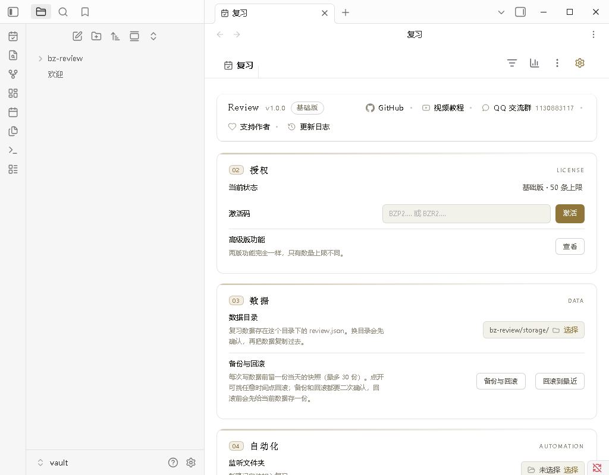
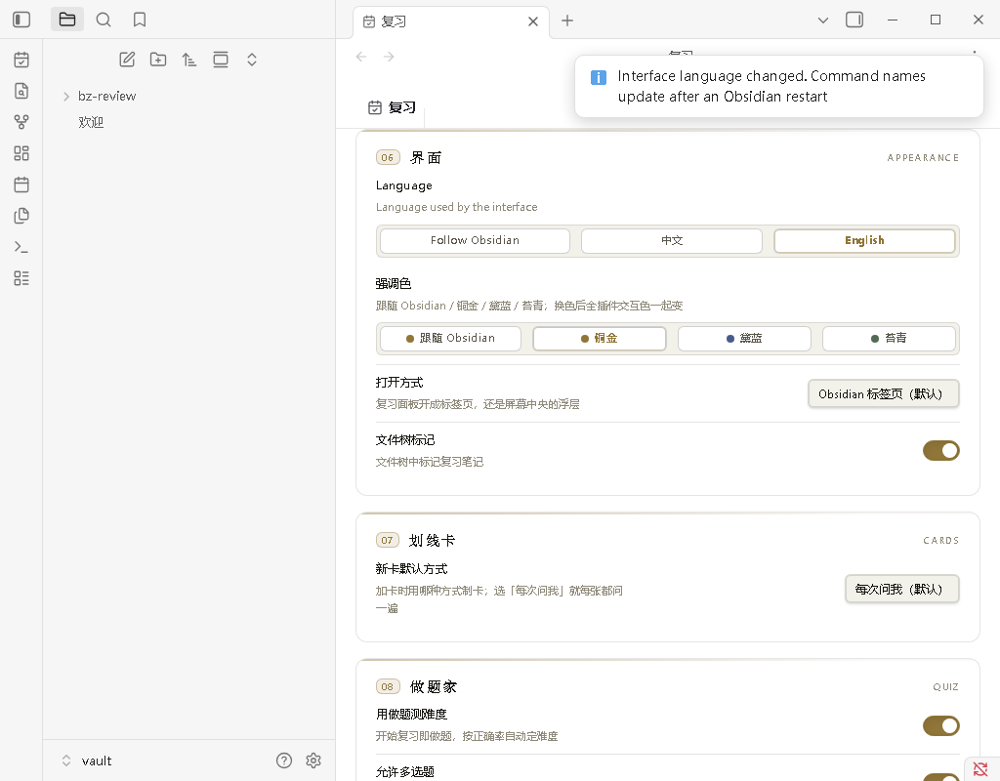
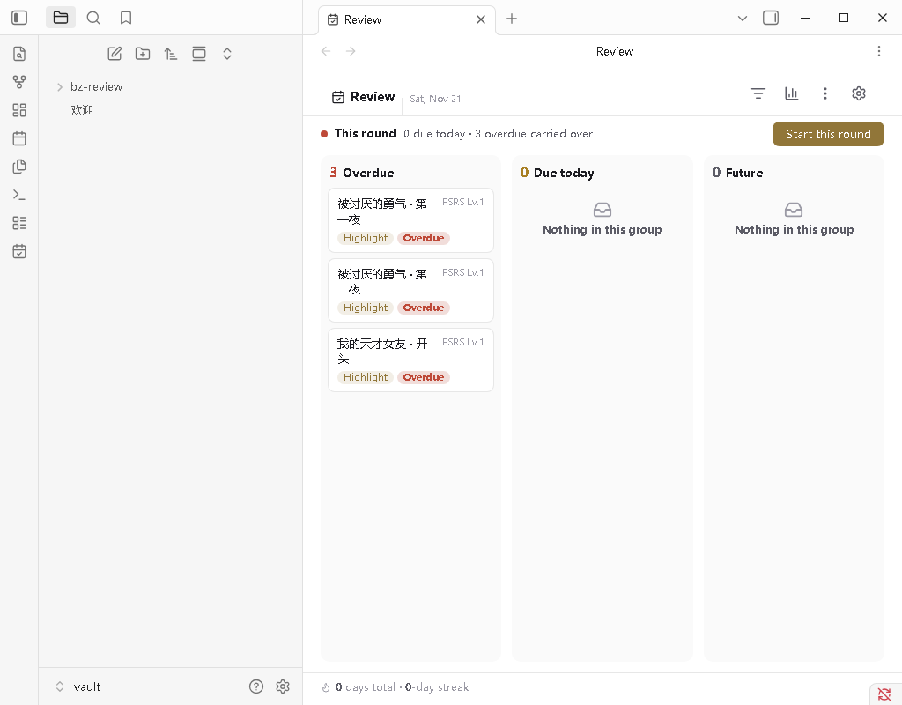
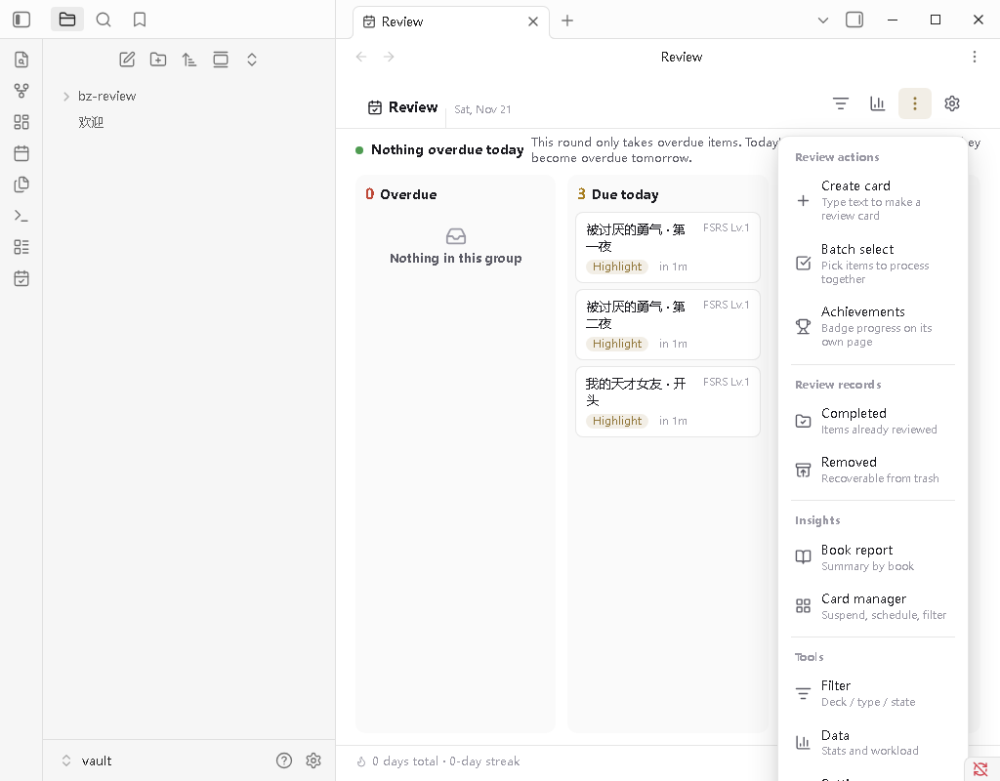
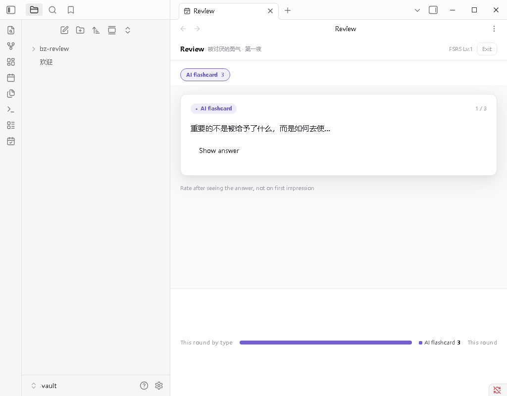

# 多语言（英文）第一批与第二批 —— 实施与真机验证

日期：2026-11-21　分支：`feat/i18n-en`（worktree `D:\Obsidian\bz-review-wt-i18n`）
状态：**未合并 master**，等确认。

## 一、做了什么

照 bz Reader 的 key 式多语言体系，把界面文案收编成语言包；先上中文（基准）+ 英文两包，语言列表按可扩展写法，以后加语言只加包。

| 批次 | 范围 | 提交 |
|---|---|---|
| 第一批 | 语言包骨架（`src/i18n/`：纯核心 + 宿主探测分层）、中英语言包、设置页「界面」组最前的语言分段器、命令 / ribbon / 右键菜单 / 通知 / 支持作者弹窗 / 关于条 / 插件组 / 快捷键 | `1bcce84` |
| 第二批 | 主面板（头行、三区列、卡片标签、更多菜单、筛选、批量条、底栏、空态）、冲刺与结算、复习卡会话、卡片方式元数据、按书档案、卡片管理器、回收站、做题练习、评级名与日期/倒计时 | `4d7907a` |

语言选择逻辑：设置里 `auto` = 跟随 Obsidian，手动选择优先；读不到宿主语言退回中文。切换后设置页整页重开、主面板下次重绘生效；命令名在插件加载时求值，需重启 Obsidian（设置页与切换通知都写明了）。

## 二、门禁

- `npm run typecheck`：通过
- `npm test`：**739 / 739 通过**（合并 master 后）
- `npm run lint`：0 error / 0 warning（css + tooltip + obsidian 三套）
- 合并 `master`（含 1.0.0 发版收口与空态改动）无冲突

## 三、真机验证（Obsidian 1.10 桌面，1024×800）

真机实例：独立库 + 独立进程，插件为 worktree 构建产物。

| 场景 | 结论 | 截图 |
|---|---|---|
| 设置页「界面」组出现语言行（跟随 Obsidian / 中文 / English） | 通过 |  |
| 点 English：整页重绘、语言行与通知变英文、设置落盘 | 通过 |  |
| 关于条五个出口英文（Video tutorials / QQ group / Support the author / Changelog） | 通过 |  |
| 支持作者弹窗框架文案英文（名单内容不译） | 通过 | 见第一批截图 |
| 重载插件后命令面板命令名为英文（Review: Open review plan…） | 通过 | — |
| 主面板英文（列头 Overdue / Due today / Future、底栏、空列提示） | 通过 |  |
| 更多菜单英文（四组标题 + 标题/副标） | 通过 |  |
| 复习卡英文（Exit / Show answer / 评级提示 / This round by type） | 通过 |  |
| 切回中文：通知与面板即时回中文 | 通过 |  |
| 语言重启后保持（写 `data.json` 的 `language`） | 通过 | — |

未覆盖：移动端布局（下一批连同弹窗一起看）、英文文案在窄栏的折行细节。

## 四、还没翻的（第三批候选）

1. **设置页所有设置行**（约 150 条 name / desc / help）——量最大，切英文后这里仍是中文。
2. 弹窗群：卡片向导、加入复习流程、来源选择、解锁窗、备份与回滚、媒体配置、模板、统计与成就、复习分析（动效页）。
3. 面板事件层文案（ui.ts：移出/恢复/批量/排期等 100+ 条 toast 与确认句）。
4. `review/app.ts` 的逾期提醒与统计弹窗。
5. 数据层错误消息（配额、备份、授权）——中文直出，英文界面下会中英混排。
6. 更新日志正文（已按 `changelogLang()` 只做中英两版，属既有机制）。

## 五、已知问题

- 命令名要重启 Obsidian 才更新（Obsidian 的 `addCommand` 只在加载时求值；设置页与通知都写了提示）。
- 英文文案在产品名 / 书名等用户内容上不译，属预期。
