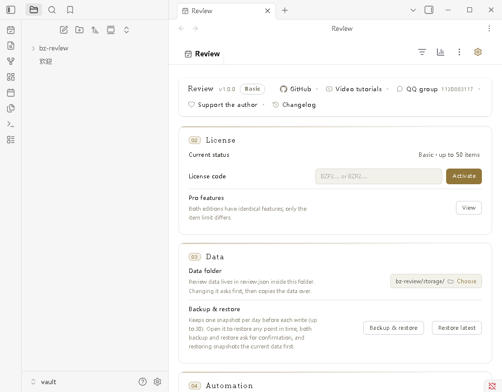
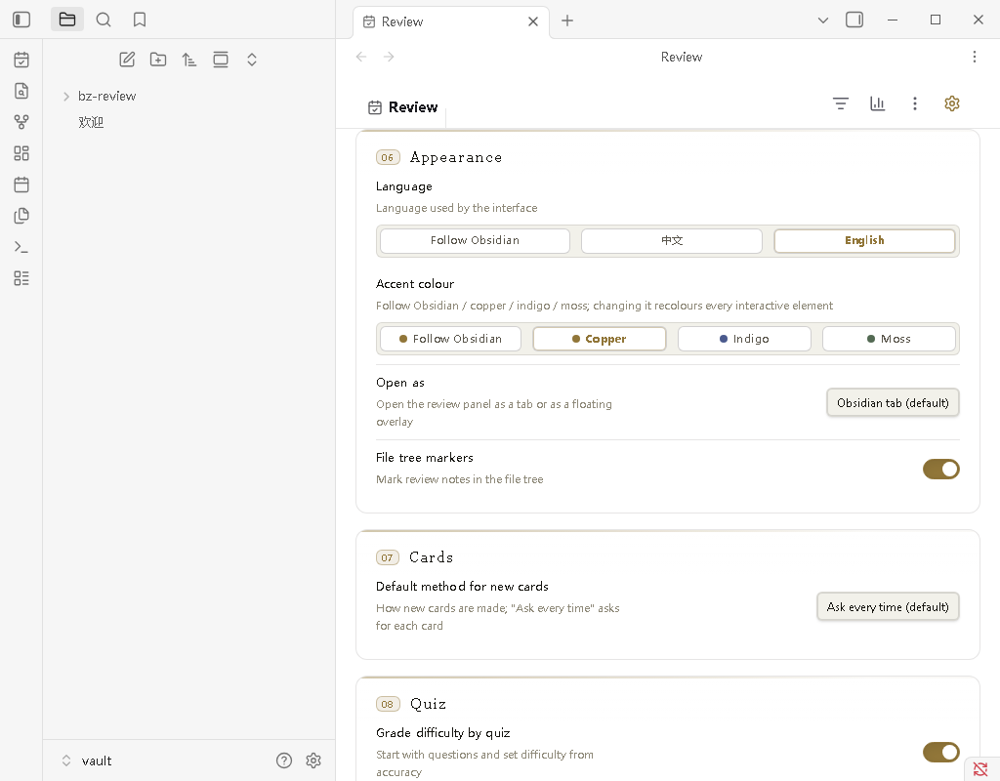
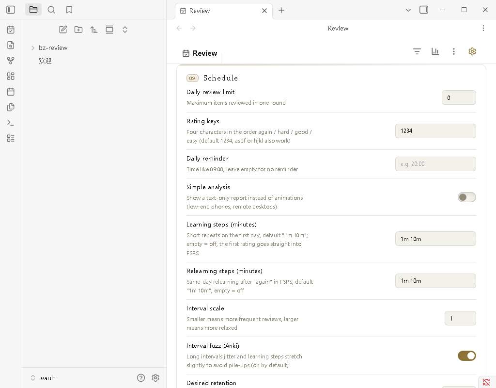
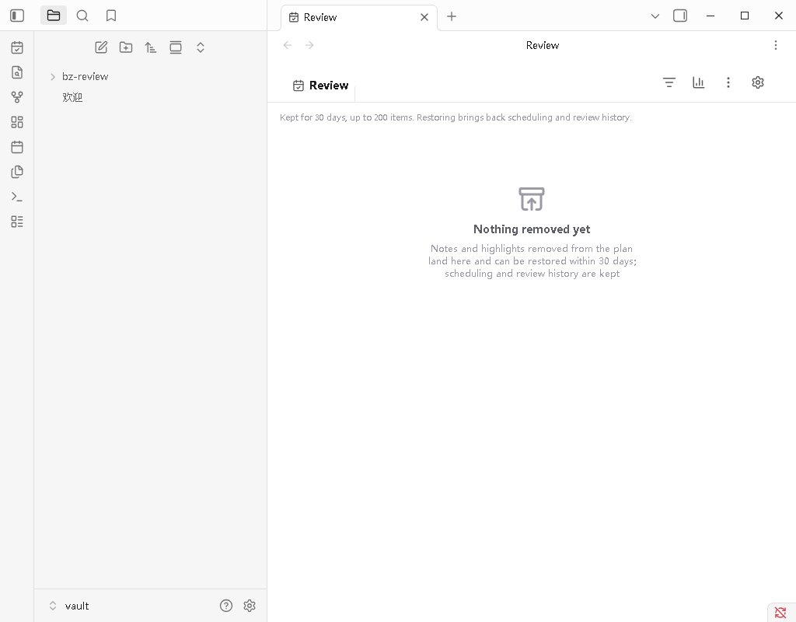
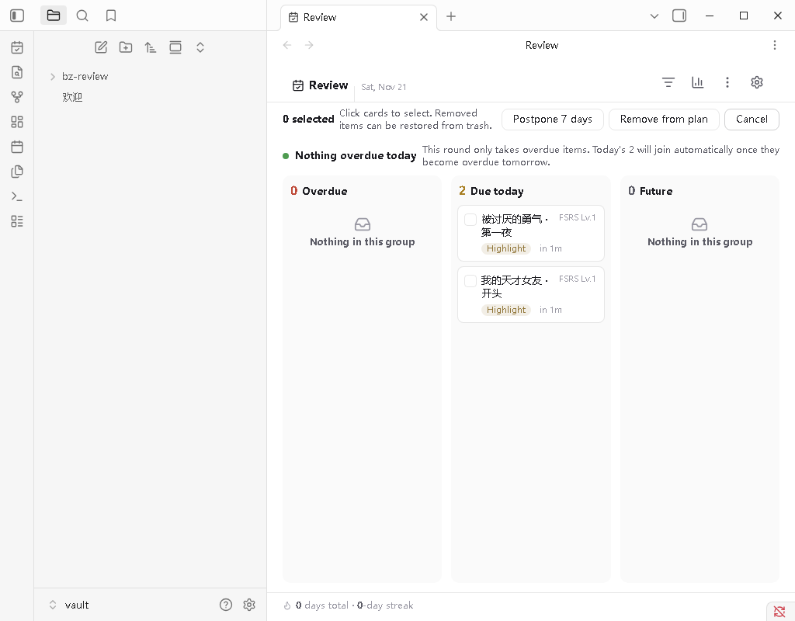
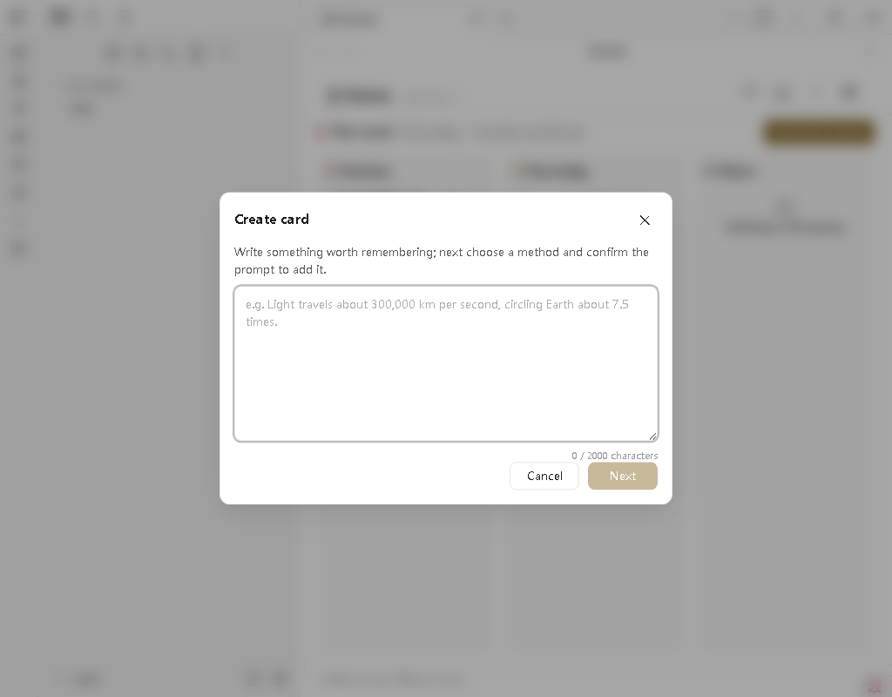
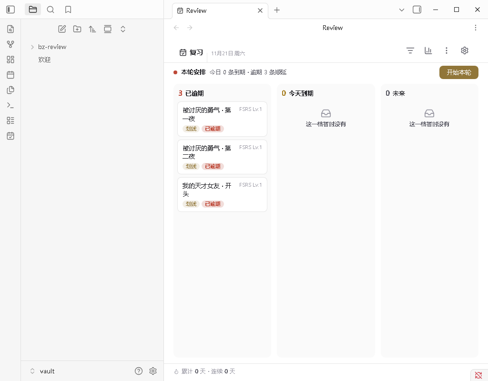
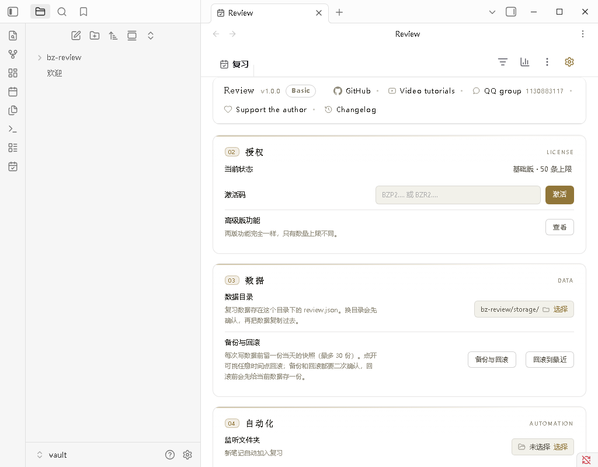

# 多语言（英文）—— 实施与真机验证

日期：2026-11-21　分支：`feat/i18n-en`（worktree `D:\Obsidian\bz-review-wt-i18n`）
状态：**未合并 master**，等确认。

## 一、做了什么

照 bz Reader 的 key 式多语言体系，把界面文案收编成语言包；先上中文（基准）+ 英文两包，语言列表按可扩展写法，以后加语言只加包。

| 批次 | 范围 | 提交 |
|---|---|---|
| 1 | 语言包骨架（`src/i18n/`：纯核心 + 宿主探测分层）、中英语言包、设置页语言分段器、命令 / ribbon / 右键菜单 / 通知 / 支持作者 / 关于条 / 插件组 / 快捷键 | `1bcce84` |
| 2 | 主面板、冲刺与结算、复习卡会话、卡片方式、按书档案、卡片管理器、回收站、做题练习、评级名与日期倒计时 | `4d7907a` |
| 3 | 设置页十一组设置行（名称 / 说明 / 悬停帮助 / 下拉选项）与分组名 | `091fe08` |
| 4 | 面板事件层 113 处 toast / 确认框 / 菜单（空态、更多菜单、移出/恢复/排期、批量、回收站、评级、重新生成、文件缺失） | `6b1d0b4` |
| 5 | 卡片向导 64 处 + 加入复习流程 27 处（选方式、确认题面、挖空编辑、补题与重生成、手输文字、文件夹勾选） | `d59a277` |
| 6 | 从阅读器挑内容 53 处（选书、按划线/章节、字数与上限提示、确认内容） | `fa73f1b` |
| 7 | 统计页与成就页：六张统计卡、记忆曲线状态、复习量对比、评级分布、到期负载、时间线、账本与环比、节律、连续与活跃、遗忘段、记忆状态、内容构成、排行、成就徽章、复习历史弹窗 | 第七批提交 |
| 8 | 解锁窗对照表、备份与回滚、媒体配置、卡片模板、手动排期、预测负荷、牌组与标签 | `92eeeb7` |
| 9 | 复习应用通知（45 处）、卡片编辑与重新生成确认、移出/顺延二次确认、CSV 与 Markdown 导出、按书档案导出、挂起与埋藏说明 | `a0d3d17` |
| 10 | AI 请求错误与连通性测试、思考档位（注册表 `labelKey`）、模型列表与选择、行内按钮三态、Reader 安装与更新提示 | `665e5bf` |
| 11 | 数据层：从 bz 迁移、配额门控、能力名、授权状态摘要、激活码格式 / 验签 / 跨插件 / 过期提示 | `e2e0e47` |
| 12 | **AI 提示词三条**（按划线挑、按章节出问答卡、四选一选择题）、Anki 导入（解析统计、媒体补选、结果汇总）、做题面板（备题进度、批量回退、提交与放弃） | `e5b1f1f` |
| 13 | 忆炉全景十六幕：幕名（底栏与灯谱）、开场与落款、各幕指标与说明、图例、单位、日期与稳定性人话、评级名、年龄分档 | `c9317c7` |
| 14 | 监听文件夹（删除同步、改名汇总、批量加入）、远程资源下载错误与校验、手册入口、数据文件留档通知、相对时间（刚刚/昨天/前天） | `251da0c` |
| 15 | 路径选择器、流程弹窗（未保存放弃）、从备份恢复、教程弹窗、支持作者与打赏榜、牌组筛选描述、AI 未配置引导、Anki 分隔符与占位文字、卡片模板字段名、多设备合并提示、冲刺放弃与跳题 | `6d64816` |

语言选择逻辑：`auto` = 跟随 Obsidian，手动选择优先；读不到宿主语言退回中文。切换后设置页整页重开、主面板下次重绘生效；命令名在插件加载时求值，需重启 Obsidian（设置页与切换通知都写明）。

## 二、门禁

- `npm run typecheck`：通过
- `npm test`：**739 / 739 通过**
- `npm run lint`：0 error / 0 warning（css + tooltip + obsidian 三套）
- 已合并 `master`（1.0.0 发版收口与空态改动）无冲突

## 三、真机验证（Obsidian 1.10 桌面，1024×800）

真机实例：独立库 + 独立进程，插件为 worktree 构建产物；`data.json` 预置 `language: "en"`。

| 场景 | 结论 | 截图 |
|---|---|---|
| 设置页授权/数据组英文（License / Basic · up to 50 items / Data folder / Backup & restore） | 通过 |  |
| 设置页界面组英文（Language / Accent colour / Open as / File tree markers，中文自称保留） | 通过 |  |
| 设置页复习节奏组英文（Daily review limit / Rating keys / Learning steps…） | 通过 |  |
| 主面板英文（Overdue / Due today / Future、底栏、空列提示） | 通过 |  |
| 更多菜单英文（四组标题 + 标题/副标） | 通过 |  |
| 复习卡英文（Exit / Show answer / 评级提示 / This round by type） | 通过 |  |
| 回收站空态英文 | 通过 |  |
| 批量选择条英文（0 selected / Postpone 7 days / Remove from plan / Cancel） | 通过 |  |
| 创建卡牌弹窗英文（Create card / 计数 / Cancel / Next） | 通过 |  |
| 切回中文：通知与面板即时回中文 | 通过 |  |
| 关于条五出口英文 | 通过 |  |
| 语言重启后保持（写 `data.json` 的 `language`） | 通过 | — |

未覆盖：移动端布局（英文更长，下一轮连同弹窗一起看）。

## 四、还没翻的（下一批候选）

1. 最后一批提示词：`cloze`（挖空）与 `flashcard`（抽认卡）两条 AI 提示词。
2. 零散收尾（约 40 条）：`jev` / `zip` / `tar` / `category-table` / `douban-name-index` / `reward-names` / `folder-pick-logic` / `rss-catalog` 等。
3. AI 服务商注册表的 18 组中文标签（`DeepSeek 密钥` / `智谱开放平台的接口密钥` 等）：品牌名 + 中文后缀，需单独定「中英同形」还是「双份标签」的方案。
4. `core/deps-*` 与 `setup-screen`：**bz-review 并不引用**（bz 主插件的共享 core 残留），不在本次范围。
5. 控制台日志保留中文原文（开发者日志，不面向用户）。
6. 更新日志正文与弹窗框架：已自带中英两版，不属未翻项。

**忆炉全景入口说明**：`openReviewAnalysis` 是导出函数，但本版本没有注册命令或界面按钮（无公开入口），本次无法真机截图，只做了构建与单测校验。

## 五、关于「AI 生成内容」的语言

第十二批已把三条出题提示词按界面语言出词：**英文界面下生成的题目、解析与问答卡为英文**，中文界面维持原样；返回结构与解析逻辑不变（JSON 契约与字段名不动）。

## 五、已知问题

- 命令名要重启 Obsidian 才更新（Obsidian 的 `addCommand` 只在加载时求值；设置页与通知都写了提示）。
- 英文文案在产品名 / 书名等用户内容上不译，属预期。
