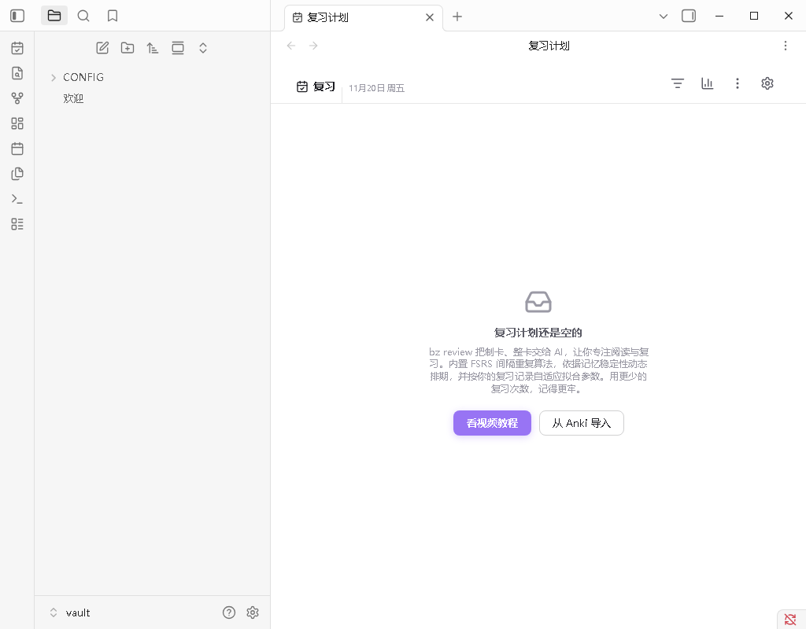
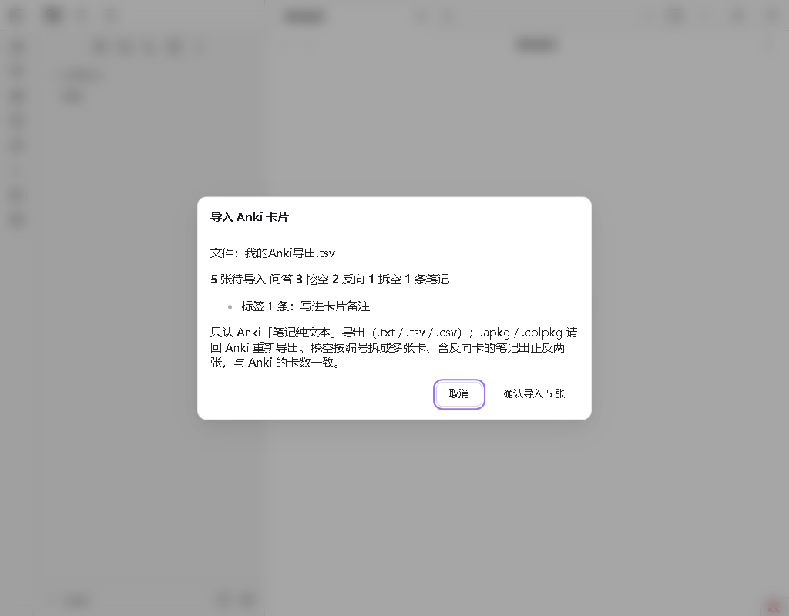
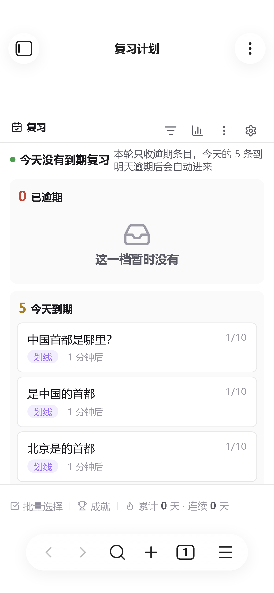

# 视频教程占位 + Anki 完整导入 · 真机验证报告

日期：2026-11-20　环境：Obsidian 真机（独立测试库 `D:\obs-test-runs\runs\bzrv-anki`，插件来自测试库 `E:/Obsidian/bz review/.obsidian/plugins/bz-review`），桌面 1024×800 + 移动 390×844@3x。

## 改动概览

| 需求 | 落点 | 状态 |
|---|---|---|
| 视频教程不留占位链接，点击弹通知 | `links-bridge.ts`（`VIDEO_TUTORIAL_URL=''` + `openVideoTutorial()`），空态 / 设置关于条 / 更新日志三处入口全接入 | ✅ |
| README 视频教程 | 中英两版各加「制作中，做好后补链接」段落，无占位 URL | ✅ |
| Anki 打开系统文件框、选库外任意文件 | `anki-import.ts` 改用 `<input type=file>`（桌面系统对话框 / 移动端系统选择器），`File.text()` 读内容不依赖路径 | ✅ |
| 严格确认完整导入、不留导不进来的卡 | `anki-cards.ts` 重写解析：文件头列声明、引号换行、网页格式、媒体占位、多挖空拆卡、正反卡、图片遮挡跳过、稳定 key 去重；补 Cloze Back Extra 丢失缺口 | ✅ |
| 导入前预览确认 | `anki-import.ts` 预览弹窗（进多少 / 跳过什么 / 媒体 / 边界），确认才写盘 | ✅ |

## 门禁

- `npm test`：62 文件 / **531 用例全过**（新增 anki-cards 15 用例）。
- `npm run typecheck`（tsc --noEmit）：通过。
- 悬停气泡属性检查 `check-tooltip-attrs.mjs`：通过（无 `aria-label` / `title` / `setTooltip`）。
- CSS 作用域 `css-scope.mjs`：通过；构建聚合正常，Anki 预览样式已进入根 `styles.css`。
- 自审 + diff 审查：命令 ID `review-import-anki` 合规；三处视频入口统一走 `openVideoTutorial()`，无残留 `window.open(VIDEO_URL)`；空态新增「从 Anki 导入」ghost 按钮避免死路。

## 真机验证（逐项）

### 1. 主界面空态 · 两颗按钮
空态同时显示紫色强调的「看视频教程」+ 白色「从 Anki 导入」，视频按钮前景/背景在强调色下可读。

### 2. 空态「看视频教程」点击 → 弹通知、不跳浏览器
真机点击后 DOM 出现 `.bzrv-notice-msg`，文本「视频教程还在制作中，做好后会在这里更新」，无外链跳转。
> CDP 截图与 toast 动画不同步，两张截图未捕捉到浮层；但 DOM 实测 `visible: true`，文本一致。

### 3. 设置页「关于条」视频入口
`app.setting.openTabById("bz-review")` 打开后，点击 `[data-act=aboutvideo]` 弹出同一条通知，DOM 核验通过。

### 4. 更新日志弹窗视频入口
`changelog-note.ts` 的 `chgnvideo` 已改为 `openVideoTutorial()`（diff 确认），与上面两处共用一个函数，逻辑同源。

### 5. Anki 系统文件选择框
执行命令 `review-import-anki` 真机捕获到动态创建的 `input[type=file]`，`accept=".txt,.tsv,.csv,text/plain,text/tab-separated-values"`。桌面端为系统原生对话框，移动端为系统文件选择器；内容经 `File.text()` 读取，**不要求文件在库内**（本次测试文件由外部注入，未放进测试库）。

### 6. Anki 导入预览确认（带牌组/标签列 + 多挖空 + 正反卡）
注入含 3 行笔记的导出文件（基础卡 / Cloze 双空 / Basic 反向），预览弹窗正确给出：

> 5 张待导入 · 问答 3 · 挖空 2 · 反向 1 · 拆空 1 条笔记 · 标签 1 条

格式边界（只认纯文本导出、.apkg 需重新导出、挖空拆卡口径）与「取消 / 确认导入 5 张」按钮齐全，数字走强调色。

### 7. 确认写盘
点「确认导入 5 张」后：弹窗关闭，通知「Anki 导入 5 张（问答 3 / 挖空 2）」；`CONFIG/REVIEW/review.json` 落盘 5 张卡。重新导出、行序变化不会重复（key 为内容/GUID 稳定哈希，15 个单测覆盖）。

### 8. 移动端布局
切移动端（390×844@3x）重开复习面板，刚导入的 5 张卡正常显示在「今天到期」列表，无横向溢出、无底部导航遮挡。

## 结论

五项需求全部落地并通过真机验证。改动只在测试库，未合并主分支、未推送。等确认后再走 worktree 合入流程。
