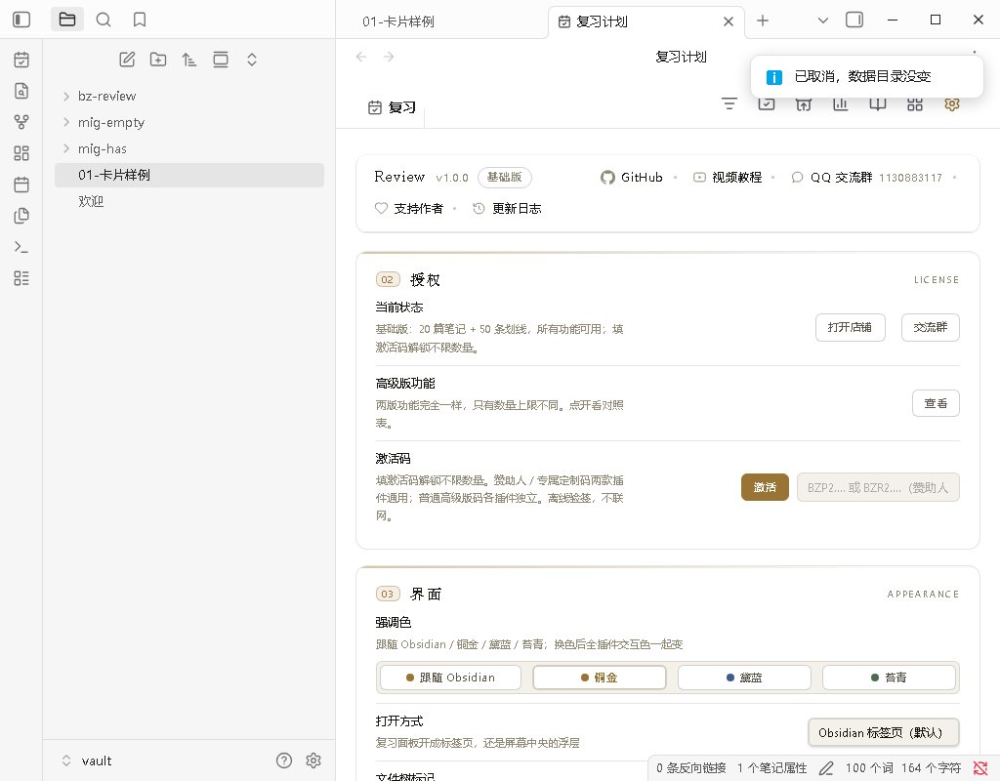
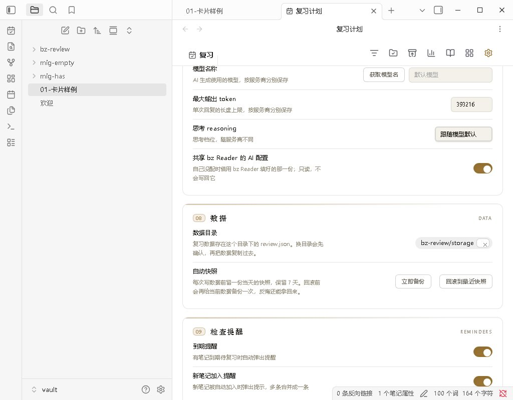

# 数据目录「取消迁移」回退 bug · 修复与真机验证

> 分支 `fix/full-review`。本文件只讲这一个 bug：现象、根因、改法、真机证据、门禁结果。
> 证据图见 [真机验证证据](真机验证证据/)（`41`–`43`）。

## 1. 现象（修复前）

在设置页改「数据目录」，选一个新目录后在确认框点**「取消」**：

- 界面提示「已取消，数据目录没变」，chip 也显示旧目录 `bz-review/storage`；
- 但 `data.json` 里 `storagePath` **已经被写成了新目录**；
- 数据实际还在旧目录 → 下次启动插件读空的新目录，看起来像「数据丢了」（其实改回去能自愈）。

## 2. 根因

通用 path 行渲染器 `src/core/settings-schema.ts` 的写盘时序：

```
onChange(list):
  v = 清单换算成的值
  acc.write(v)            ← 先写内存
  safePersist(acc.persist())  ← 先落盘（此时已写入新目录）
  res = 域回调 onChange(...)  ← 弹确认框；取消时返回 [prev] 回退清单
  异步分支 .then(final → 返回 final 给 chips 渲染)  ← 只回退了界面，没回写 binding / 落盘
```

原先代码注释写着「异步否决场景的落盘改写由回调自行负责」，但数据目录的取消分支只 `return [prev]`，并没有回写 settings 与落盘——两处都没做，于是落盘停在被否决的新值。

## 3. 改法（最小、统一）

契约（`:280-282` 注释）本来就是「回调返回的清单 = 落盘口径」，所以修在通用渲染器，**所有** path 行（数据目录、监听文件夹、排除名单）的异步否决都统一生效，不必逐个改域回调：

1. 把「清单→绑定值」和「值是否变更」抽成纯函数 `src/core/path-value.ts`（零 obsidian 依赖，单测直接跑）：
   - `pathListToValue(multi, list)`：single 取首项去首尾斜杠；multi 数组副本。
   - `pathValueChanged(multi, written, final)`：判断最终值是否与已写盘值不同（即是否被否决/改写）。
2. `settings-schema.ts` 的 path 行 `onChange` 增加 `applyFinal(finalList)`：若 `finalV !== v`，把 binding 与落盘一起修正（`acc.write(finalV)` + `safePersist`），并更新回滚锚点 `applied`。同步分支与异步分支**都走** `applyFinal`。

这样「界面回退」与「落盘回退」变成同一个动作，不会再各写一份。

## 4. 真机验证（真实 Obsidian 进程）

### 4.1 取消迁移 → 三处一致回退（核心）

在确认框点「取消」后读三处值：

| 位置 | 修复前 | 修复后 |
|---|---|---|
| 内存 `settings.storagePath` | 新目录 `mig-empty` | `bz-review/storage` ✅ |
| 落盘 `data.json` | 新目录 `mig-empty` | `bz-review/storage` ✅ |
| chip 显示 | 旧目录 | `bz-review/storage` ✅ |
| 老数据 | 4 张仍在旧目录 | 4 张仍在旧目录 ✅ |


图释：取消后提示「已取消，数据目录没变」。


图释：滚到「数据目录」行，chip 显示 `bz-review/storage`，与落盘一致（修复前此时落盘已是新目录）。

### 4.2 正常确认迁移不受影响（回归检查）


图释：选 `mig-empty` 后确认框文案完整（旧目录保留、搬错可自愈、有数据不覆盖）。

确认后核对：内存与落盘均为 `mig-empty`；新目录 4 张、旧目录仍 4 张（复制不移动）。重启后 `storagePath=mig-empty`、读到 4 张卡，控制台零错误。**修复只作用于「final ≠ 已写值」的否决/改写场景，正常确认（final = 写入值）不会触发回写，逻辑上不影响正常路径，真机也确认了。**

## 5. 门禁结果

- `tsc --noEmit`：0 error
- `lint-obsidian` / `lint-css` / tooltip：全绿
- 单元测试：**496 全过**（原 490 + 新增 6 条 `tests/path-revert.test.ts`），58 个文件全过
- 3 个 `Errors` 仍是本机 jsdom 缺 `@asamuzakjp/dom-selector` 的环境噪声，与代码无关

## 6. 改动文件（均在 worktree `fix/full-review`）

| 文件 | 改动 |
|---|---|
| `src/core/path-value.ts` | 新增：path 值换算/变更判定纯函数 |
| `src/core/settings-schema.ts` | 导入纯函数；path 行 `onChange` 增加 `applyFinal`，同步/异步两路都回退 binding + 落盘；转发导出纯函数 |
| `tests/path-revert.test.ts` | 新增：6 条回归测试（纯函数口径 + 渲染器两路回退断言） |

**未合并、未发版、未推主库。**
